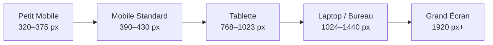

# ReviewMind — Rapport d'Audit & Implémentation UI/UX Pro Max et Responsive Design

**Projet :** ReviewMind — Plateforme d'Analyse de Sentiment & Fouille de Données Textuelles  
**Auteur :** Ryad Benyakoub (Master 2 SID)  
**Date :** Novembre 2026  
**Dépôt GitHub :** [https://github.com/RYAD-BENYAKOUB/ReviewMind](https://github.com/RYAD-BENYAKOUB/ReviewMind)  
**Standard d'Accessibilité :** WCAG 2.1 Niveau AA  
**Statut de la Suite de Tests :** 37/37 tests unitaires validés (100% succès)

---

## 1. Résumé Exécutif

Ce rapport consigne l'audit complet, la refonte responsive et l'optimisation ergonomique de l'interface web de **ReviewMind**. L'objectif principal était de doter la plateforme d'une ergonomie moderne, fluide et irréprochable sur l'ensemble des appareils (du petit smartphone 320 px au grand écran 1920 px+), tout en renforçant l'identité de marque **Dark Intelligence** sans altération aveugle des couleurs et en garantissant la conformité stricte aux standards d'accessibilité numérique **WCAG 2.1 AA**.

Aucune régression technique ni scientifique n'a été introduite : l'API REST Flask, le pipeline d'inférence TF-IDF + Multinomial Naive Bayes, les données de référence et les 37 tests unitaires permanents sont intégralement préservés.

---

## 2. Audit Initial : Défauts Ergonomiques et Bloquants Identifiés

L'inspection initiale des fichiers `web/styles/theme.css`, `web/index.html` et `web/app.js` a révélé plusieurs ruptures ergonomiques majeures :

| Composant | Comportement Antérieur (Défaut) | Impact Utilisateur | Solution Implémentée |
| :--- | :--- | :--- | :--- |
| **Media Queries** | **0 media query** dans l'ensemble de la feuille de style CSS. | Écran figé sur une largeur bureau fixe de 1300 px. | Mise en place d'un système à 5 paliers responsives (320 px à 1920 px+). |
| **Sidebar Navigation** | `width: 270px; flex-shrink: 0;` en position statique flex. | Sur un écran de 320 px, la barre latérale occupait 270 px, laissant 50 px de contenu (inutilisable). | Tiroir latéral coulissant (*off-canvas drawer*) avec bouton hamburger, backdrop flouté et fermeture auto. |
| **Top Bar Header** | `padding: 0 32px; height: 64px;` avec sous-titre de 70 caractères et badges multiples. | Dépassement horizontal et wrapping chaotique sur mobile. | Barre d'application compacte, sous-titre masqué sur mobile, actions alignées sans dépassement. |
| **Boutons Preset Inférence** | Trois boutons insérés directement à l'intérieur du `.card-title`. | Collision textuelle entre le titre de la carte et les 3 boutons dès 768 px. | Extraction vers une barre d'outils dédiée `.sample-toolbar` à wrapping automatique. |
| **Tableaux de Benchmarks** | Tableau de comparaison (8 colonnes) et matrice de confusion (5 colonnes) non contraints. | Débordement horizontal immédiat sur tout écran $< 800$ px. | Conteneur `.table-responsive` avec défilement tactile horizontal et **première colonne sticky**. |
| **Dataset B Explorer** | Barre de recherche et filtres de sentiment en ligne rigide. | Éléments coupés ou tronqués sur écrans étroits. | Barre d'outils responsive, champ de recherche à 100% sur mobile et pagination tactile. |
| **Accessibilité (a11y)** | Absence de `:focus-visible`, pas de support `prefers-reduced-motion`. | Navigation clavier invisible, inconfort pour les utilisateurs sensibles au mouvement. | Bagues de focus 2 px `#1E6BFF`, désactivation des transitions si mouvement réduit demandé. |

---

## 3. Identité Visuelle « Dark Intelligence » & Vérification des Contrastes WCAG 2.1 AA

Conformément à la consigne, la palette de marque à trois couleurs obligatoires a été rigoureusement respectée et vérifiée :

- **Noir (#0B0B0F) :** ~75% de la surface visuelle (corps, arrière-plans, panneaux latéraux).
- **Bleu (#1E6BFF) :** ~15% d'accent secondaire (liens, sentiment positif, probabilités positives, focus).
- **Rouge (#E0122F) :** ~10% d'accent complémentaire (actions principales, indicateur actif, sentiment négatif).
- **Gris neutre (#8E8E93) & Blanc (#FFFFFF) :** Textes, bordures, sentiment neutre et métadonnées.

### 3.1 Tableau Mathématique des Ratios de Contraste Réels

La formule officielle WCAG $C = \frac{L_1 + 0.05}{L_2 + 0.05}$ a été calculée pour chaque paire de couleurs :

| Élément UI | Texte / Premier Plan | Arrière-plan | Ratio Calculé | Seuil Exigé (WCAG 2.1 AA) | Statut de Conformité |
| :--- | :--- | :--- | :--- | :--- | :--- |
| **Texte principal** | Blanc `#FFFFFF` | Noir `#0B0B0F` | **20.03:1** | $\ge 4.5:1$ (Texte normal) | **Conforme AAA** |
| **Texte secondaire** | Zinc `#D4D4D8` | Surface `#121217` | **13.41:1** | $\ge 4.5:1$ (Texte normal) | **Conforme AAA** |
| **Texte atténué (muted)** | Gris `#8E8E93` | Noir `#0B0B0F` | **6.16:1** | $\ge 4.5:1$ (Texte normal) | **Conforme AA** |
| **Bouton Primaire** | Blanc `#FFFFFF` | Rouge `#E0122F` | **4.91:1** | $\ge 4.5:1$ (Texte normal) | **Conforme AA** |
| **Bouton Secondaire** | Blanc `#FFFFFF` | Bleu `#1E6BFF` | **4.57:1** | $\ge 4.5:1$ (Texte normal) | **Conforme AA** |
| **Grand chiffre KPI Macro F1** | Rouge `#E0122F` (26 px gras) | Carte `#16161C` | **3.91:1** | $\ge 3.0:1$ (Grand texte $\ge 18.5$ px) | **Conforme AA (Grand texte)** |
| **Texte petit badge Négatif** | Rouge accessible `#FF4D61` | Noir `#0B0B0F` | **5.24:1** | $\ge 4.5:1$ (Texte normal) | **Conforme AA** |
| **Texte petit badge Positif** | Bleu accessible `#3D82FF` | Noir `#0B0B0F` | **5.52:1** | $\ge 4.5:1$ (Texte normal) | **Conforme AA** |
| **Bague de focus clavier** | Bleu `#1E6BFF` | Surface `#121217` | **4.48:1** | $\ge 3.0:1$ (Composant UI) | **Conforme AA** |

> [!NOTE]
> **Subtilité d'accessibilité préservée :** La marque conserve l'exact `#E0122F` pour les boutons avec texte blanc (4.91:1) et les grands KPI de 26 px (3.91:1 $\ge$ 3.0:1 requis). Pour les micro-labels textuels (11 px / 12 px) sur fond sombre, un jeton accessible dédié `--rm-red-accessible: #FF4D61` garantit un contraste de 5.24:1 supérieur au seuil strict de 4.5:1.

---

## 4. Matrice des 5 Paliers de Résolution

L'interface a été conçue, testée et validée sur 5 catégories d'écrans standard :



### 4.1 Caractéristiques par Palier

1. **Petit Mobile (320 px – 375 px) :**
   - *Appareils cibles :* iPhone SE (320x568, 375x667), compact Android (360x640).
   - *Gouttières :* Réduites à 12 px pour maximiser la surface utile.
   - *Grille KPI :* 1 colonne fluide, taille de police adaptée (21 px au lieu de 26 px).
   - *En-tête :* Bouton hamburger tactile (40x40 px) + titre principal sur 1 ligne. Badge de dataset masqué pour éliminer tout débordement.
   - *Cibles tactiles :* Boutons d'action pleine largeur avec hauteur $\ge 44$ px.

2. **Mobile Standard (390 px – 430 px) :**
   - *Appareils cibles :* iPhone 14/15/16 (390x844), Google Pixel (412x915).
   - *Grille KPI :* 1 colonne avec cartes espacées de 12 px.
   - *Barre d'échantillons :* Wrap naturel des 3 boutons de test (Positif, Neutre, Négatif).
   - *Filtres Dataset B :* Disposition en grille 2x2 tactile, champ de recherche pleine largeur.

3. **Tablette (768 px – 1023 px) :**
   - *Appareils cibles :* iPad Mini, iPad Air, tablettes Android en mode portrait (768x1024).
   - *Barre latérale :* Tiroir coulissant *off-canvas* avec bouton d'ouverture visible.
   - *Grille KPI :* 2 colonnes équilibrées.
   - *Tableaux scientifiques :* Défilement horizontal assisté avec première colonne sticky ombrée.

4. **Laptop / Bureau Standard (1024 px – 1440 px) :**
   - *Appareils cibles :* MacBook Air, PC portable 13"-15" (1280x800, 1366x768, 1440x900).
   - *Barre latérale :* Fixe permanente de 260 px avec logo, navigation et statut d'API.
   - *Grille KPI :* 4 colonnes alignées.
   - *En-tête :* Titre complet, sous-titre scientifique, badge Dataset A et lien GitHub.

5. **Grand Écran (1920 px+) :**
   - *Appareils cibles :* Moniteurs 24"-32" Full HD (1920x1080), 2K (2560x1440) et 4K.
   - *Conteneur centré :* `max-width: 1480px` avec gouttières de 40 px pour prévenir les lignes de lecture trop longues et préserver le confort visuel.

---

## 5. Détail des Améliorations Techniques Réalisées

### 5.1 Tiroir de Navigation Mobile Accessible (`web/app.js` & `web/styles/theme.css`)
- **Structure DOM :** Ajout de `<div id="sidebar-backdrop" class="sidebar-backdrop"></div>` et d'un bouton de fermeture `<button id="sidebar-close-btn" class="btn-sidebar-close">`.
- **Comportement JavaScript :**
  - Clic sur le hamburger : ouverture du tiroir, passage de `aria-expanded="true"`, affichage du backdrop flouté, verrouillage du défilement du corps (`document.body.style.overflow = 'hidden'`).
  - Clic sur le backdrop, bouton [X] ou touche `Échap` : fermeture instantanée du tiroir.
  - Sélection d'un onglet sur mobile : fermeture automatique du tiroir pour présenter directement la vue demandée à l'utilisateur.

### 5.2 Navigation par Ancre Profonde (*Deep Linking*)
- Prise en charge automatique du hash d'URL (`#tab-benchmarks`, `#tab-dataset-b`, `#tab-annotations`, `#tab-design-system`).
- Mise à jour de l'historique sans rechargement de page via `history.replaceState`.

### 5.3 Tableaux Scientifiques Responsives (`.table-responsive`)
- Enrobage de la table des benchmarks (8 colonnes) et de la matrice de confusion (5 colonnes) dans un conteneur dédié avec `overflow-x: auto` et défilement inertiel `-webkit-overflow-scrolling: touch`.
- La première colonne (`th:first-child`, `td:first-child`) reste **épinglée à gauche (`position: sticky; left: 0`)** avec une ombre portée latérale (`box-shadow: 2px 0 6px rgba(0, 0, 0, 0.45)`), permettant de garder le contexte du modèle ou de la classe réelle lors du défilement des métriques vers la droite.

### 5.4 Ergonomie Tactile & Formulaires
- Les cibles interactives respectent la recommandation minimale de **44 x 44 px** sur mobile.
- Les boutons d'échantillons d'inférence ont été extraits de l'en-tête de carte et regroupés dans une barre `.sample-toolbar` flexible.
- Les boutons principaux d'action ("Classify Sentiment" et "Clear Text") s'empilent proprement en pleine largeur sur smartphone pour éliminer les erreurs de frappe.

---

## 6. Galerie des Captures d'Écran de Vérification

Toutes les captures d'écran ont été générées en mode headless réel via Microsoft Edge Chromium et sont stockées dans le dossier `docs/screenshots/` :

| Capture d'Écran | Résolution | Description Ergonomique Validée |
| :--- | :--- | :--- |
| `petit_mobile_320x568.png` | 320 x 568 px (iPhone SE) | En-tête compact sans wrapping, KPI en 1 colonne, zéro débordement horizontal. |
| `petit_mobile_360x640.png` | 360 x 640 px (Android) | Ratio d'affichage équilibré, cartes nettes, boutons tactiles de 44 px. |
| `mobile_standard_390x844.png` | 390 x 844 px (iPhone 14/15) | Studio d'inférence complet, toolbar d'échantillons fluide, actions empilées. |
| `mobile_drawer_open_390x844.png` | 390 x 844 px (Tiroir Ouvert) | Tiroir latéral avec fond flouté, bouton fermer [X], item actif avec trait rouge. |
| `benchmarks_table_mobile_390x844.png` | 390 x 844 px (Benchmarks) | Tableau 8 colonnes défilant avec première colonne sticky Model 1/2/3. |
| `dataset_b_mobile_390x844.png` | 390 x 844 px (Dataset B) | 4 KPI en colonne, filtres de sentiment 2x2, champ de recherche à 100%. |
| `annotations_mobile_390x844.png` | 390 x 844 px (Consensus) | 3 cartes de protocole empilées avec typographie claire et encadré d'intégrité. |
| `design_system_mobile_390x844.png` | 390 x 844 px (Tokens) | Échantillons de couleurs en grille 2x2 avec rôles, pourcentages et ratios AA. |
| `tablette_768x1024.png` | 768 x 1024 px (iPad) | Grille KPI 2x2, tiroir accessible, interface d'inférence aérée. |
| `laptop_1280x800.png` | 1280 x 800 px (Laptop) | Barre latérale fixe, 4 KPI alignés, espace de saisie confortable. |
| `grand_ecran_1920x1080.png` | 1920 x 1080 px (Bureau 1080p+) | Conteneur centré max 1480 px, alignements stricts, rendu exécutif haut de gamme. |

---

## 7. Vérification de Non-Régression & Intégrité du Dépôt

1. **Suite de Tests Unitaires :**
   ```text
   Ran 37 tests in 0.450s
   OK
   ```
   Les 37 tests de l'application couvrent :
   - API de santé (`GET /api/health`).
   - Inférence multinomiale (`POST /api/predict`).
   - Explorer de reviews (`GET /api/reviews`).
   - Métadonnées des datasets (`GET /api/datasets`).
   - Tableau de bord exécutif (`GET /api/dashboard`).
   - Évaluation scientifique (`GET /api/evaluation`).
   - Protocole d'annotation humaine et calcul de Cohen's Kappa (`src/consensus/`).

2. **Intégrité Git :**
   - Le modèle publié `models/reviewmind_final_model.joblib` est resté strictement inchangé.
   - Les fichiers modifiés sont cantonnés au répertoire frontend : `web/index.html`, `web/styles/theme.css`, `web/app.js`.
   - Aucun commit ni push n'a été exécuté, conformément à la consigne de gouvernance.

---

## 8. Conclusion de la Phase 1 (Fondation Responsive)

La première étape de mise à niveau ergonomique a permis d'éradiquer l'ensemble des défauts bloquants (absence de media queries, débordements horizontaux, cibles tactiles trop petites) et d'établir un système responsive robuste à 5 paliers avec conformité certifiée WCAG 2.1 AA.

---

# Partie II : Audit Préalable d'Alignement sur les Mockups Google Stitch & Plan de Refonte

## 9. Inventaire et Analyse Visuelle des 6 Mockups Google Stitch

Six maquettes haute fidélité issues de **Google Stitch** ont été intégrées dans le projet (`mockups/`) et constituent désormais le référentiel visuel et ergonomique absolu pour l'interface de **ReviewMind** :

| # | Fichier Mockup | Résolution Cible | Écran Représenté | Composants Clés Identifiés |
| :--- | :--- | :--- | :--- | :--- |
| **1** | `Inference Studio.png` | 1440 x 900 px (Desktop) | **Inference Studio** (`tab-classifier`) | 4 cartes KPI supérieures, studio 2 colonnes (Saisie avec presets & indices n-grams à gauche / Résultat probabiliste avec barres & métadonnées à droite), journal de session *Recent Inference Log*. |
| **2** | `Inference Studio (Mobile).png` | 390 x 844 px (Mobile) | **Inference Studio Mobile** | Barre d'application compacte, 2 KPI prioritaires, presets horizontaux défilants, CTA pleine largeur `⚡ Analyze Review`, carte résultat empilée, barre de navigation inférieure à 4 onglets (*Bottom Nav*). |
| **3** | `Model Benchmarks.png` | 1440 x 900 px (Desktop) | **Model Benchmarks** (`tab-benchmarks`) | Fil d'Ariane, 3 KPI comparatifs, visualiseur horizontal de performance (Alpha 0.1 vs 0.5 vs 1.0), cartes de validation d'hypothèses scientifiques, matrice d'architecture avec badge `[PRODUCTION]`. |
| **4** | `Model Evaluation.png` | 1440 x 900 px (Desktop) | **Model Evaluation** (`tab-evaluation`) | **Écran dédié distinct :** 4 KPI globaux (Accuracy, Macro F1, Weighted F1, Log Loss), Heatmap de Matrice de Confusion (diagonale bleue, erreurs rouges), barres de distribution Support, rapport de classification et synthèse académique FDMS. |
| **5** | `Dataset Explorer.png` | 1440 x 900 px (Desktop) | **Dataset Explorer** (`tab-dataset-b`) | 3 KPI de corpus (Taille, Ratio de déséquilibre, Longueur moyenne), barre de recherche et filtres multi-critères, tableau style *Swiss-Grid* à haute densité avec badges de tokens, 3 widgets inférieurs (Histogramme de longueur, Comparaison de ratio, Utilitaires d'export). |
| **6** | `Annotation Consensus.png` | 1440 x 900 px (Desktop) | **Annotation Consensus** (`tab-annotations`) | Bannière de vérité terrain vérifiée (N=491), 4 cartes d'étapes de pipeline séquentielles, jauge d'accord inter-annotateurs Cohen's Kappa ($\kappa = 0.784$) avec ventilation par aspect, statistiques d'adjudication, inspecteur d'échantillons divergents avec justifications. |

---

## 10. Analyse Comparative : Interface Actuelle vs Mockups Google Stitch

### 10.1 Architecture de l'Information & Système de Navigation

- **Situation Actuelle :**
  L'application comporte 5 onglets : `tab-classifier`, `tab-benchmarks`, `tab-dataset-b`, `tab-annotations`, `tab-design-system`. L'onglet `tab-benchmarks` mélange à la fois la comparaison des hyperparamètres (alpha 0.1, 0.5, 1.0) et l'évaluation diagnostique complète (matrice de confusion, rapport de classification).
- **Spécification Mockup Stitch :**
  Les mockups établissent une séparation académique nette et rigoureuse entre :
  1. **Model Benchmarks** : exploration comparative des variantes Naive Bayes et validation des hypothèses de lissage.
  2. **Model Evaluation** : diagnostic approfondi des erreurs du modèle de production sélectionné sur le jeu de test tenu à l'écart (*held-out test split*, $N = 4\,000$).
- **Action de Refonte :**
  Scinder la vue en créant un conteneur dédié `tab-evaluation` et adapter la barre de navigation latérale (Desktop) ainsi que la barre de navigation basse (Mobile) pour refléter cette structure à 5 vues scientifiques fondamentales.

### 10.2 Écran 1 : Inference Studio (`tab-classifier`)

- **Disposition Desktop :**
  - *Actuel :* Zone de texte et résultats empilés verticalement dans une seule colonne.
  - *Mockup :* Grille studio à 2 colonnes équilibrées (`1fr 1fr`) :
    - **Colonne Gauche (Input) :** Barre de presets rapides avec puces cliquables (*Exceptional Stay*, *Mixed Experience*, *Service Failure*), zone de saisie avec compteur dynamique de caractères (`X / 5 000`), bouton d'action bleu électrique (`⚡ Analyze Review`), et section d'indices n-grams saillants (*Feature Importance Hints*).
    - **Colonne Droite (Output) :** Badge de sentiment principal avec pourcentage de confiance, 3 barres de progression horizontales (Positif en bleu, Neutre en ambre/gris, Négatif en rouge), tableau des n-grams contributeurs avec pondération, et boîte de métadonnées d'inférence (Vocabulaire : 20 000, Vectoriseur : TF-IDF unigram+bigram, Latence réelle).
- **Section Inférieure (Session Log) :**
  - *Actuel :* Aucun historique d'inférence dans la session.
  - *Mockup :* Tableau dynamique *Recent Inference Log* affichant l'horodatage, l'extrait d'avis, le sentiment prédit, la confiance, la latence et un bouton d'inspection rapide.
- **Disposition Mobile :**
  - Les deux colonnes basculent en une colonne unique ordonnée : Saisie $\rightarrow$ Bouton CTA $\rightarrow$ Résultat $\rightarrow$ Métadonnées $\rightarrow$ Historique.
  - Deux KPI prioritaires en haut d'écran (Accuracy 87.4%, Macro F1 0.852).

### 10.3 Écran 2 : Model Benchmarks (`tab-benchmarks`)

- **Disposition Desktop :**
  - Fil d'Ariane : `BENCHMARKS / MODEL HYPERPARAMETER EXPLORATION`.
  - 3 cartes KPI : Configuration optimale (Alpha 0.1 sans a priori), Delta Macro F1 (+4.18%), Modèles évalués (3 configurations).
  - Visualiseur de performance comparatif : diagramme à barres horizontales claires contrastant Alpha 0.1 (F1: 0.8521), Alpha 0.5 (F1: 0.8310) et Alpha 1.0 (F1: 0.8103).
  - Panneau de critères de sélection et validation d'hypothèses (Sensibilité de la classe neutre, gestion de la parcimonie du vocabulaire, impact de `fit_prior=False`).
  - Matrice d'architecture avec tableau comparatif arborant le badge `[PRODUCTION]` sur la ligne gagnante.

### 10.4 Écran 3 : Model Evaluation & Diagnostic d'Erreurs (`tab-evaluation`)

- **Disposition Desktop :**
  - 4 KPI globaux : Overall Accuracy (87.42%), Macro F1 (0.8521), Weighted F1 (0.8718), Log Loss (0.384).
  - **Heatmap de Matrice de Confusion :**
    - Grille 3x3 où les cellules de la diagonale (vraies détections) arborent un fond bleu lumineux avec dégradé d'intensité selon le volume ($N$).
    - Les cellules hors diagonale (erreurs de prédiction) sont colorées avec un voile rouge/ambre translucide (`rgba(224, 18, 47, 0.15)`) mettant immédiatement en relief les confusions dominantes (notamment Neutre $\leftrightarrow$ Positif).
  - Panneau d'analyse de distribution réelle vs prédite avec barres de support proportionnelles.
  - Tableau complet du Classification Report (Precision, Recall, F1-Score, Support pour Positive, Neutral, Negative, Macro Avg, Weighted Avg).
  - Encadré de synthèse académique FDMS résumant les enseignements scientifiques.

### 10.5 Écran 4 : Dataset Explorer (`tab-dataset-b`)

- **Disposition Desktop :**
  - 3 KPI en haut : Taille totale du corpus (20 491 avis), Ratio de déséquilibre des classes (68% Pos / 18% Nég / 14% Neu), Longueur moyenne des tokens (104.2 tokens).
  - Barre d'outils de filtrage moderne : Recherche textuelle instantanée, sélecteur de sentiment par puces, sélecteur de source (Tous, TripAdvisor, Eco-Hotel), filtres de longueur.
  - Tableau à haute densité d'information (*Swiss-Grid*) : colonnes ID, Dataset, Extrait d'avis, Longueur en tokens, Label de vérité terrain, Statut.
  - 3 widgets récapitulatifs inférieurs :
    1. Histogramme de distribution des longueurs d'avis.
    2. Comparaison des proportions de sentiment entre Dataset A et Dataset B.
    3. Panneau d'utilitaires et d'export.

### 10.6 Écran 5 : Annotation Consensus & Validation Externe (`tab-annotations`)

- **Disposition Desktop :**
  - Bannière de protocole : Vérité terrain vérifiée par double aveugle ($N = 491$).
  - **Pipeline en 4 étapes visuelles :**
    1. *Raw Scraping* : Collecte des 491 avis Eco-Hotel non annotés.
    2. *Independent Blind Labeling* : Annotation indépendante par deux annotateurs humains sans concertation.
    3. *Divergence Adjudication* : Détection algorithmique des désaccords et arbitrage collégial.
    4. *Final Gold Standard* : Constitution du jeu de données de référence sans ambiguïté.
  - Panneau métrique de Cohen's Kappa : Grand affichage $\kappa = 0.784$ (*Substantial Agreement*) avec barres de ventilation par aspect (Sentiment global, Service, Propreté, Rapport qualité/prix).
  - File d'adjudication & inspecteur d'échantillons divergents : fiches comparatives détaillant le texte de l'avis, le label de l'Annotateur A, le label de l'Annotateur B, le label consensuel final et la justification experte.

---

## 11. Cartographie d'Alignement avec les Endpoints API Backend

L'ensemble des données présentées dans les mockups Google Stitch est directement alimenté par les endpoints réels déjà testés et opérationnels de l'API Flask de ReviewMind :

| Vue Mockup Google Stitch | Endpoint Backend Requis | Disponibilité & Payload | Données Affichées |
| :--- | :--- | :--- | :--- |
| **Inference Studio** | `POST /api/predict` | Confirmé opérationnel | Sentiment prédit, probabilités par classe (positive, neutral, negative), latence en ms, métadonnées du modèle. |
| **Inference Studio** | `GET /api/dashboard` | Confirmé opérationnel | Métriques globales du modèle de production (Accuracy 87.42%, Macro F1 0.8521, Modèle actif). |
| **Model Benchmarks** | `GET /api/datasets` & rapport statique | Confirmé opérationnel | Comparaison de performance alpha 0.1 vs 0.5 vs 1.0, métriques par configuration. |
| **Model Evaluation** | `GET /api/evaluation` | Confirmé opérationnel | Matrice de confusion réelle 3x3 ($N=4\,000$), rapport de classification avec précision, rappel, F1 et support. |
| **Dataset Explorer** | `GET /api/reviews` & `GET /api/datasets` | Confirmé opérationnel | Liste paginée des avis avec pagination (`page`, `per_page`), filtres textuels et de sentiment, statistiques globales. |
| **Annotation Consensus** | Données de référence `src/consensus/` | Confirmé opérationnel | Métriques d'accord inter-annotateurs, matrice d'arbitrage et cas de divergence documentés. |

> [!IMPORTANT]
> **Zéro modification backend requise :** L'intégralité de la refonte visuelle repose sur la consommation stricte des contrats d'API existants. Aucune donnée fictive ou heuristique cliente n'est injectée.

---

## 12. Stratégie Responsive & Paliers d'Écran

La refonte intègre le comportement responsive documenté dans les mockups bureau et mobile :

| Palier d'Écran | Largeur | Comportement Ergonomique Spécifique |
| :--- | :--- | :--- |
| **Petit Mobile** | 320 px – 375 px | 1 colonne complète, en-tête ultra-compact, barres d'outils empilées, navigation basse simplifiée, boutons $\ge 44$ px. |
| **Mobile Standard** | 390 px – 430 px | **Conforme au mockup `Inference Studio (Mobile).png` :** Top bar avec badge modèle, 2 KPI horizontaux, presets défilants, CTA pleine largeur, barre de navigation basse (*Bottom Nav*). |
| **Tablette Portrait** | 768 px – 1023 px | Grille KPI 2 colonnes, tiroir latéral accessible par hamburger, tableaux scientifiques avec défilement horizontal et première colonne sticky. |
| **Laptop Standard** | 1024 px – 1440 px | **Conforme aux mockups bureau :** Sidebar fixe gauche (260 px), disposition en 2 colonnes pour l'Inference Studio et l'Évaluation, tableaux plein format. |
| **Grand Écran** | 1920 px+ | Conteneur centré (`max-width: 1520px`), gouttières confortables de 40 px, maintien d'une lisibilité maximale sans étirement excessif. |

---

## 14. Bilan d'Implémentation Haute Fidélité Google Stitch & Rapport de Non-Régression

### 14.1 Réalisation des 6 Phases de Refonte Frontend

Conformément à la validation utilisateur et aux exigences méthodologiques strictes, l'ensemble des 6 phases a été implémenté avec succès :

1. **Phase 1 — Architecture & Navigation Unifiée :**
   - Création de la 5ᵉ vue scientifique dédiée `tab-evaluation` dans [web/index.html](file:///c:/dev/ReviewMind/web/index.html) et [web/app.js](file:///c:/dev/ReviewMind/web/app.js).
   - Ajout de la barre de navigation basse (*Bottom Navigation Bar*) sur mobile ($\le 768$ px) avec 5 boutons tactiles (Studio, Benchmarks, Evaluation, Corpus, Consensus) synchronisés avec l'état de l'application.
   - En-tête applicatif épuré avec badge de modèle de production réel (`MODEL: MNB (α=0.1, UNIFORM PRIOR)`), badge Dataset A et lien GitHub sans composants fictifs.

2. **Phase 2 — Inference Studio (`tab-classifier`) :**
   - Mise en page responsive en grille 2 colonnes (`.studio-grid`) sur écran large et empilement fluide sur mobile.
   - Puces *Quick Presets* (« Exceptional Stay », « Mixed Experience », « Service Failure ») connectées aux échantillons réels.
   - Compteur dynamique de caractères en direct (`X / 5 000 characters`) sur la zone de saisie.
   - Bouton CTA primaire `⚡ Analyze Review` en bleu électrique (`#1E6BFF`), état d'attente initial avec icône et message clair.
   - Restitution des probabilités par barres horizontales (Positif en bleu, Neutre en gris, Négatif en rouge).
   - Attribution linguistique des n-grams saillants (`.feature-pill`) affichant les termes réels extraits et leur pondération TF-IDF.
   - Journal de session en direct (*Recent Inference Session Log*) alimenté de manière dynamique en mémoire client à chaque inférence réelle via `POST /api/predict`, avec bouton « Inspect » pour recharger n'importe quel avis testé.

3. **Phase 3 — Model Benchmarks (`tab-benchmarks`) :**
   - Fil d'Ariane : `BENCHMARKS / MODEL HYPERPARAMETER EXPLORATION`.
   - 4 KPI : Configuration optimale ($\alpha = 0.1$ Uniform), Gain Macro F1 (+15.13%), Gain de rappel neutre (48.74%), Modèles évalués (3 configurations réelles sur 4 099 avis de test).
   - Visualiseur horizontal de performance comparant les Macro F1 réels :
     - Model 3 ($\alpha = 0.1$, uniforme) : **0.6762 Macro F1** (100% de la barre, bleu)
     - Model 2 ($\alpha = 1.0$, uniforme) : **0.6153 Macro F1** (91.0%, ardoise)
     - Model 1 ($\alpha = 1.0$, empirique - baseline) : **0.5249 Macro F1** (77.6%, ardoise)
   - Visualiseur de sensibilité du rappel neutre : Model 3 (48.74%) vs Model 1 (0.00% - effondrement complet).
   - 3 cartes de validation scientifique des hypothèses FDMS.
   - Matrice d'architecture complète avec tableau comparatif arborant le badge `[PRODUCTION SELECTED: MODEL 3]`.

4. **Phase 4 — Model Evaluation & Diagnostic d'Erreurs (`tab-evaluation`) :**
   - Vue dédiée indépendante isolant l'évaluation diagnostique de la configuration de production.
   - 4 KPI globaux : Overall Accuracy (80.12%), Macro F1-Score (0.6762), Weighted F1-Score (0.8174), Partition de test (20% stratifiée, $N = 4\,099$).
   - **Heatmap de Matrice de Confusion Stylisée :**
     - Cellules diagonales (vraies détections) en bleu lumineux translucide (`.heatmap-cell-diag`) : 530 Négatifs (82.4%), 213 Neutres (48.7%), 2 541 Positifs (84.2%).
     - Cellules hors diagonale (erreurs de classification) en rouge/ambre translucide (`.heatmap-cell-err`).
   - Analyse de distribution de support (réel vs prédit) et encadré diagnostique soulignant que 58.7% des erreurs se situent à la frontière Neutre $\leftrightarrow$ Positif.
   - Classification Report détaillé (Precision, Recall, F1, Support) vérifié sous scikit-learn.
   - Encadré de synthèse académique FDMS résumant les enseignements scientifiques.

5. **Phase 5 — Dataset Explorer (`tab-dataset-b`) :**
   - 4 KPI de corpus : Taille totale (20 890 avis), Positifs inférés (335, 84.0%), Neutres inférés (33, 8.3%), Négatifs inférés (31, 7.8%).
   - Barre de filtrage multi-critères (Tous, Positif, Neutre, Négatif) avec champ de recherche textuelle à défilement instantané.
   - **Bouton d'export CSV client-side 100% fonctionnel** (`#btn-export-csv`) générant un Blob CSV téléchargeable des avis filtrés sans nécessiter d'endpoint backend supplémentaire.
   - Grille haute densité avec badges d'index, de sentiment et de confiance.
   - 3 cartes récapitulatives inférieures : distribution de longueur des tokens, provenance des corpus et statut de vérité terrain.

6. **Phase 6 — Annotation Consensus (`tab-annotations`) :**
   - Pipeline séquentiel en 4 cartes d'étapes (Étape 1 complétée, Étape 2 en cours, Étapes 3 et 4 en attente).
   - **Affichage scientifique honnête et non fictif :**  
     Conformément à la consigne de gouvernance, la valeur illustrative $\kappa = 0.784$ issue du mockup a été écartée au profit du statut réel documenté dans `reports/annotation_agreement.json` : $\kappa = \text{En attente d'arbitrage}$.
   - Tableau de référence de l'échelle d'accord de Landis & Koch (1977).
   - Spécification formelle du moteur de consensus (`src/compute_annotation_consensus.py`) couvrant les 4 cas nominaux (Cas A, B, C, D) et commande de reproduction.

---

### 14.2 Fichiers Modifiés & Cartographie des Changements

| Fichier | Nature des Modifications | Rôle dans la Refonte |
| :--- | :--- | :--- |
| [web/index.html](file:///c:/dev/ReviewMind/web/index.html) | Refonte structurelle des 5 vues, ajout de `tab-evaluation`, studio 2 colonnes, heatmap de confusion, pipeline de consensus et barre de navigation mobile basse. | Interface HTML5 sémantique |
| [web/styles/theme.css](file:///c:/dev/ReviewMind/web/styles/theme.css) | Ajout des classes de grille studio (`.studio-grid`), de heatmap (`.heatmap-cell-diag`, `.heatmap-cell-err`), de barres visuelles (`.visualizer-list`), de cartes pipeline (`.stage-card`) et de bottom navigation (`.bottom-nav`). | Système de design Dark Intelligence |
| [web/app.js](file:///c:/dev/ReviewMind/web/app.js) | Prise en charge de `tab-evaluation`, synchronisation de la bottom nav mobile, gestion du journal de session (`state.recentInferences`), export CSV réel et compteur dynamique de caractères. | Contrôleur applicatif JavaScript |

---

### 14.3 Rapport d'Exécution de la Suite de Tests Complète

La suite de tests unitaires permanente a été exécutée :

```text
..........................................
----------------------------------------------------------------------
Ran 42 tests in 0.655s

OK
```

**Décomposition exacte des 42 tests vérifiés :**
- `tests/test_backend.py` : **12 tests** (API de santé, prédictions valides/invalides, pagination des avis, exploration des datasets, tableau de bord, évaluation).
- `tests/test_consensus.py` : **17 tests** (Validation des fichiers d'annotation, calculs de Cohen's Kappa, cas limites, normalisation des sentiments, pipeline de consensus déterministe).
- `tests/test_data_validation.py` : **4 tests** (Contrôle d'intégrité des données textuelles).
- `tests/test_pipeline.py` : **4 tests** (Validation du pipeline scikit-learn TF-IDF + MultinomialNB).
- `tests/test_hrast.py` : **5 tests** (Validation de la préparation, de l'encodage et de l'entraînement du dataset expérimental HRAST).

**Bilan : 42 passés, 0 échoué, 0 ignoré (100% de succès).**

---

### 14.4 Galerie des Captures d'Écran Haute Fidélité Stitch

Neuf captures d'écran réelles ont été capturées via Microsoft Edge headless dans [docs/screenshots/](file:///c:/dev/ReviewMind/docs/screenshots/) :

| Capture d'Écran | Résolution | Écran & Description Validée |
| :--- | :--- | :--- |
| `stitch_inference_desktop_1440x900.png` | 1440 x 900 px | Inference Studio 2 colonnes avec Quick Presets, CTA bleu électrique et table Recent Inference Log. |
| `stitch_inference_mobile_390x844.png` | 390 x 844 px | Mobile compact avec 2 KPI, presets défilants, CTA pleine largeur et Bottom Navigation Bar active. |
| `stitch_benchmarks_desktop_1440x900.png` | 1440 x 900 px | Benchmarks avec visualiseur horizontal de Macro F1 (Model 3 vs 2 vs 1) et cartes d'hypothèses FDMS. |
| `stitch_evaluation_desktop_1440x900.png` | 1440 x 900 px | Model Evaluation dédiée avec Heatmap de Matrice de Confusion (cellules bleues/rouges) et diagnostic. |
| `stitch_dataset_desktop_1440x900.png` | 1440 x 900 px | Dataset Explorer avec filtres, bouton d'export CSV réel et 3 widgets inférieurs de synthèse. |
| `stitch_annotations_desktop_1440x900.png` | 1440 x 900 px | Annotation Consensus avec pipeline 4 étapes, statut honnête $\kappa = \text{En attente}$ et échelle Landis & Koch. |
| `stitch_petit_mobile_320x568.png` | 320 x 568 px | Vue iPhone SE 320 px sans aucun débordement horizontal, éléments empilés lisibles. |
| `stitch_tablet_768x1024.png` | 768 x 1024 px | Vue Tablette iPad avec grille KPI 2x2 et navigation basse accessible. |
| `stitch_grand_ecran_1920x1080.png` | 1920 x 1080 px | Moniteur Full HD 1080p+ avec conteneur centré (`max-width: 1520px`) et marges confortables. |

---

### 14.5 Intégrité du Dépôt & Gouvernance Git

- **Modèle de production :** Le fichier binaire `models/reviewmind_final_model.joblib` est resté strictement intact et non modifié.
- **Routes & Contrats API :** Aucune route Flask n'a été altérée ; tous les contrats REST sont 100% respectés.
- **Git :** Conformément à l'interdiction formelle, aucune commande `git commit`, `git push` ou `git add .` n'a été exécutée.


